<div align="center">


<br/>

[](https://www.linkedin.com/in/krishinfowork/)
[](https://portfolio-jk-two.vercel.app)
[](mailto:jayakrishxn@gmail.com)
<br/>


</div>

---

## 👋 About me

<table>
  <tr><td>🎓 <b>Studied</b></td><td>B.Tech Information Technology, Sri Manakula Vinayagar Engineering College, Puducherry</td></tr>
  <tr><td>📅 <b>Graduated</b></td><td>2026, CGPA 7.90</td></tr>
  <tr><td>📍 <b>Based in</b></td><td>Tamil Nadu, India 🇮🇳</td></tr>
  <tr><td>💚 <b>Loves</b></td><td>AI &amp; LLM apps · computer vision · full-stack web · testing things until they break</td></tr>
  <tr><td>🗣️ <b>Speaks</b></td><td>Python · TypeScript · JavaScript · SQL · PHP</td></tr>
  <tr><td>🤝 <b>Open to</b></td><td>New opportunities and collaborations</td></tr>
  <tr><td>⚡ <b>Fun fact</b></td><td>I write tests for my tests.</td></tr>
</table>

---

## 🧰 Tools I reach for

<p align="center">
  <br/>
  <br/>
  
</p>

<p align="center">
  
  
  
  
  
  
  
  
</p>

---

## 🚀 Things I've built

<table>
<tr>
<td width="50%" valign="top">

### 🧪 [FanCare LLM Quality](https://github.com/Jrkrish/fancare-llm-quality "🔗 Open the repo")
A support chatbot for a smart ceiling fan, and the test platform that tries to break it.

- Answers from product docs with citations, and checks orders, warranty and tickets through tools
- Reads uploaded warranty cards with OCR
- Evals, red-team attacks and a CI gate that blocks a worse prompt from merging

`FastAPI` `DeepEval` `promptfoo` `GitHub Actions`

</td>
<td width="50%" valign="top">

### 🛫 [DevPilot](https://github.com/Jrkrish/Devpilot-SDLC "🔗 Open the repo")
Give it one requirement and it walks the whole software lifecycle.

- Writes user stories, design docs, code, security notes and test cases
- A LangGraph state machine routes each stage, with a human approve/feedback step in between
- Every phase is saved as a downloadable Markdown file

`LangGraph` `Redis` `Python`

</td>
</tr>
<tr>
<td width="50%" valign="top">

### 🤖 [SDLC Agents](https://github.com/Jrkrish/SDLC-Agents "🔗 Open the repo")
A team of AI agents that each own one step of building software.

- Pick an LLM (Gemini, Groq or OpenAI), describe the project, and let the agents work
- Produces user stories, specs, code, tests and a production-readiness check
- Runs as a Streamlit app

`Python` `Streamlit` `Gemini` `Groq`

</td>
<td width="50%" valign="top">

### 📄 [AI Resume Generator](https://github.com/Jrkrish/Resume "🔗 Open the repo")
ATS-friendly resumes in minutes.

- Gemini writes the content from your details
- Instant PDF download rendered with PDFKit
- Razorpay payments with multiple pricing tiers, mobile-friendly UI

`Flask` `Gemini API` `Razorpay` `Tailwind`

</td>
</tr>
<tr>
<td width="50%" valign="top">

### 👁️ [Wrinkle Detection](https://github.com/Jrkrish/Wrinkle-Detection "🔗 Open the repo")
Finds and outlines wrinkles on a face photo.

- YOLOv8s segmentation fine-tuned on 3 classes: forehead, frown and wrinkle
- Upload a photo in the Streamlit app and get masks drawn back on it

`YOLOv8` `OpenCV` `Streamlit`

</td>
<td width="50%" valign="top">

### 🦴 [Spine Segmentation](https://github.com/Jrkrish/Yolo-Spine "🔗 Open the repo")
Spots each vertebra on a spine scan automatically.

- YOLOv8 detects L1 to L5 and the S1 sacrum and boxes each one
- Built to cut the manual labelling work in medical imaging

`YOLOv8` `Python` `Streamlit`

</td>
</tr>
<tr>
<td width="50%" valign="top">

### 🩺 [Skin Cancer Prediction](https://github.com/Jrkrish/Skin-Cancer-Prediction "🔗 Open the repo")
A quick check on a photo of a skin lesion.

- Upload an image and a trained model classifies the lesion
- Served through a simple Flask web app

`Flask` `Python` `Jupyter`

</td>
<td width="50%" valign="top">

### 🎨 [Studio Infinity](https://github.com/Jrkrish/Company-Portfolio "🔗 Open the repo")
A minimalist site for a creative studio. **[See it live →](https://company-portfolio-sage.vercel.app/)**

- Custom cursor, smooth page transitions and a dark, minimal look
- Filterable portfolio and a validated contact form

`Next.js 15` `TypeScript` `Tailwind`

</td>
</tr>
</table>

---

## 🔀 Open pull request

<table>
<tr>
<td>

 &nbsp;**Add Jayakrishnan to your team** <code>#2026</code>

<sub>**jrkrish** wants to merge 1 commit into `your-team:main` from `jrkrish:class-of-2026`</sub>

```diff
  team = [
      "you",
      "your brilliant colleagues",
+     "Jayakrishnan",  # AI apps · computer vision · full-stack web
  ]
```

<details>
<summary>✅ <b>All checks have passed</b> · 6 successful checks <sub>(click to view)</sub></summary>
<br/>

| | Check | Details |
| :-: | --- | --- |
| ✅ | `build / ships-real-projects` | 8 public projects, from YOLOv8 vision models to LLM agents |
| ✅ | `learn / new-stacks-fast` | PHP in 2024 → YOLOv8, Flask, Next.js in 2025 → LangGraph agents in 2026 |
| ✅ | `test / quality-gate` | Builds CI gates that block a merge when quality drops |
| ✅ | `lint / reads-the-docs` | Docs first, Stack Overflow second, guessing never |
| ✅ | `deploy / ready-to-start` | B.Tech IT, graduated 2026, open to opportunities |
| ✅ | `fuel / filter-coffee` | Level: critical ☕ |

</details>

<details>
<summary>💬 <b>1 review requested</b> · that's you <sub>(click to view)</sub></summary>
<br/>

> **Reviewer checklist**
> - [x] Read the project cards above
> - [x] Peeked at the GitHub stats below
> - [ ] Said hello

The last box is on you 👇
</details>

✔️ **This branch has no conflicts with the base branch.** Merging can be performed automatically.

[](mailto:jayakrishxn@gmail.com?subject=Merging%20your%20pull%20request%20%232026)
[](https://www.linkedin.com/in/krishinfowork/)

</td>
</tr>
</table>

---

## 📊 GitHub stats

<div align="center">

<picture>
  <source media="(prefers-color-scheme: dark)" srcset="https://streak-stats.demolab.com/?user=Jrkrish&theme=github-dark-blue&hide_border=true&ring=0E9F8E&fire=0E9F8E&currStreakLabel=0E9F8E" />
  
</picture>
<picture>
  <source media="(prefers-color-scheme: dark)" srcset="https://github-profile-summary-cards.vercel.app/api/cards/repos-per-language?username=Jrkrish&theme=github_dark" />
  
</picture>

<sub>🐍 and here's a snake eating my contribution graph, one green square at a time</sub>

<picture>
  <source media="(prefers-color-scheme: dark)" srcset="https://raw.githubusercontent.com/Jrkrish/Jrkrish/output/github-snake-dark.svg" />
  
</picture>

</div>

---

<div align="center">

**Got an idea, a role, or just want to say hi? My inbox is open.**

[](https://www.linkedin.com/in/krishinfowork/)
[](mailto:jayakrishxn@gmail.com)


</div>


