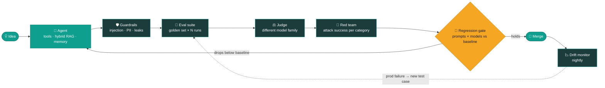

<div align="center">


<br/>

[](https://www.linkedin.com/in/krishinfowork/)
[](https://portfolio-jk-two.vercel.app)
[](mailto:jayakrishxn@gmail.com)
<br/>
[](https://github.com/Jrkrish)


</div>

---

## `$ whoami`

```python
class Jayakrishnan:
    education = "B.Tech Information Technology · Sri Manakula Vinayagar Engineering College, Puducherry"
    graduated = 2026
    cgpa      = 7.90
    based_in  = "Villupuram, Tamil Nadu 🇮🇳"

    focus     = ["AI agents & LLM apps", "AI testing & evaluation",
                 "computer vision", "full-stack web"]
    languages = ["Python", "TypeScript", "JavaScript", "SQL", "PHP"]
    open_to   = "new opportunities and collaborations"

    def fun_fact(self):
        return "I write tests for my tests."
```

---

## 🔁 How I ship an LLM feature



---

## 🧰 Tech arsenal

<p align="center">
  <br/>
  <br/>
  
</p>

<div align="center">

**Agents & LLMs** &nbsp;


**AI quality & testing** &nbsp;


**Vision** &nbsp;


</div>

---

## 🚀 Things I've built

> Click a project to look under the hood.

<details>
<summary><b>🧪 FanCare LLM Quality</b> · a support agent, and the platform that tries to break it</summary>
<br/>

**Repo:** [Jrkrish/fancare-llm-quality](https://github.com/Jrkrish/fancare-llm-quality)

- **Agent:** tool-calling loop over 5 tools (orders, warranty, recommendations, tickets, doc search) with injected timeouts, malformed and empty responses
- **Retrieval:** BM25 + vector search + cross-encoder reranking over 19 product docs; every claim cites `[DOC-xx:n]`, and with no evidence it refuses
- **Uploads:** pulls serial number, model and purchase date out of PDFs and photos with OCR, including noisy scans
- **Guardrails:** a separate layer for prompt injection, PII redaction, system-prompt leaks and poisoned retrieved passages
- **Evals:** 66-case golden set × N runs with variance, a judge from a different model family, hand-labelled judge calibration
- **Red team:** 42 attack cases plus promptfoo, attack success rate per category
- **CI:** regression gate across 3 prompt versions × 2 models blocks merges; nightly drift job
- **Tests:** API (OpenAPI-validated), Playwright UI, Locust load, SQL data checks, Appium skeleton, flaky-test quarantine

`FastAPI` `DeepEval` `promptfoo` `fastembed` `SQLite` `Docker` `GitHub Actions`
</details>

<details>
<summary><b>🛫 DevPilot</b> · from one requirement to a delivered project</summary>
<br/>

**Repo:** [Jrkrish/Devpilot-SDLC](https://github.com/Jrkrish/Devpilot-SDLC)

- State-driven LangGraph workflow with conditional routing across the whole SDLC
- Generates requirements, user stories, functional and technical design docs, code, security recommendations and test cases
- Redis-backed state

`LangGraph` `Redis` `Python`
</details>

<details>
<summary><b>🤖 SDLC Agents</b> · a team of AI agents running the dev lifecycle</summary>
<br/>

**Repo:** [Jrkrish/SDLC-Agents](https://github.com/Jrkrish/SDLC-Agents)

- AI agents automate the software development lifecycle end to end, driven from a Streamlit UI

`Python` `Streamlit`
</details>

<details>
<summary><b>📄 AI Resume Generator</b> · ATS-friendly resumes in minutes</summary>
<br/>

**Repo:** [Jrkrish/Resume](https://github.com/Jrkrish/Resume)

- Gemini writes the content, PDFKit renders the PDF, Razorpay handles tiered payments

`Flask` `Gemini API` `Razorpay` `Tailwind`
</details>

<details>
<summary><b>👁️ Wrinkle Detection</b> · YOLOv8 segmentation on faces</summary>
<br/>

**Repo:** [Jrkrish/Wrinkle-Detection](https://github.com/Jrkrish/Wrinkle-Detection)

- YOLOv8s segmentation fine-tuned on 3 classes: forehead, frown, wrinkle
- Upload a photo and get masks back in a Streamlit app

`YOLOv8` `OpenCV` `Streamlit`
</details>

<details>
<summary><b>🦴 Spine Segmentation</b> · finding vertebrae automatically</summary>
<br/>

**Repo:** [Jrkrish/Yolo-Spine](https://github.com/Jrkrish/Yolo-Spine)

- Detects the L1–L5 vertebrae and the S1 sacrum to cut manual annotation work in medical imaging

`YOLOv8` `Python`
</details>

<details>
<summary><b>🩺 Skin Cancer Prediction</b> · lesion classification on the web</summary>
<br/>

**Repo:** [Jrkrish/Skin-Cancer-Prediction](https://github.com/Jrkrish/Skin-Cancer-Prediction)

- Flask app that classifies an uploaded skin-lesion image

`Flask` `Python`
</details>

<details>
<summary><b>🎨 Studio Infinity</b> · a studio site with motion</summary>
<br/>

**Repo:** [Jrkrish/Company-Portfolio](https://github.com/Jrkrish/Company-Portfolio) · **Live:** [company-portfolio-sage.vercel.app](https://company-portfolio-sage.vercel.app/)

- Custom cursor, smooth animations, filterable portfolio, contact form with validation

`Next.js 15` `TypeScript` `Tailwind`
</details>

---

## 🧪 Unit-testing myself

```console
$ pytest tests/test_jayakrishnan.py -v
test_builds_things_that_work ............. PASSED
test_picks_up_new_stacks_fast ............ PASSED
test_reads_the_docs_first ................ PASSED
test_coffee_level ........................ PASSED  (critical)
test_ships_without_tests ................. XFAIL   (never happens)
test_gives_up_on_a_bug ................... XFAIL   (not in this lifetime)

================= 4 passed, 2 xfailed in 0.42s =================
```

---

## 📊 GitHub analytics

<div align="center">

<picture>
  <source media="(prefers-color-scheme: dark)" srcset="https://github-profile-summary-cards.vercel.app/api/cards/profile-details?username=Jrkrish&theme=github_dark" />
  
</picture>

<picture>
  <source media="(prefers-color-scheme: dark)" srcset="https://github-profile-summary-cards.vercel.app/api/cards/stats?username=Jrkrish&theme=github_dark" />
  
</picture>
<picture>
  <source media="(prefers-color-scheme: dark)" srcset="https://streak-stats.demolab.com/?user=Jrkrish&theme=github-dark-blue&hide_border=true&ring=0E9F8E&fire=0E9F8E&currStreakLabel=0E9F8E" />
  
</picture>

<picture>
  <source media="(prefers-color-scheme: dark)" srcset="https://github-profile-summary-cards.vercel.app/api/cards/repos-per-language?username=Jrkrish&theme=github_dark" />
  
</picture>
<picture>
  <source media="(prefers-color-scheme: dark)" srcset="https://github-profile-summary-cards.vercel.app/api/cards/most-commit-language?username=Jrkrish&theme=github_dark" />
  
</picture>

<picture>
  <source media="(prefers-color-scheme: dark)" srcset="https://raw.githubusercontent.com/Jrkrish/Jrkrish/output/github-snake-dark.svg" />
  
</picture>

</div>

---

<div align="center">

**Building something with LLMs and want it to actually be reliable? Let's talk.**

[](https://www.linkedin.com/in/krishinfowork/)
[](mailto:jayakrishxn@gmail.com)

</div>


