<!--
  The Jayakrishnan Times. Every page is an SVG:
    output branch  header.svg, numbers.svg   rebuilt nightly by .github/workflows/snake.yml (scripts/build-daily.mjs)
    assets/        everything else           rebuilt by `node scripts/build-static.mjs` after editing it or assets/src/
-->




<a href="https://github.com/Jrkrish/fancare-llm-quality"></a>

<a href="https://github.com/Jrkrish/Devpilot-SDLC"></a>
<a href="https://github.com/Jrkrish/SDLC-Agents"></a>
<a href="https://github.com/Jrkrish/Wrinkle-Detection"></a>
<a href="https://github.com/Jrkrish/Yolo-Spine"></a>
<a href="https://github.com/Jrkrish/Resume"></a>
<a href="https://github.com/Jrkrish/Skin-Cancer-Prediction"></a>

<a href="https://github.com/Jrkrish/Company-Portfolio"></a>


 
<a href="https://www.linkedin.com/in/krishinfowork/"></a><a href="https://portfolio-jk-two.vercel.app"></a><a href="https://github.com/Jrkrish"></a>

✂️ every tab is a real link, and every story above opens its repo

